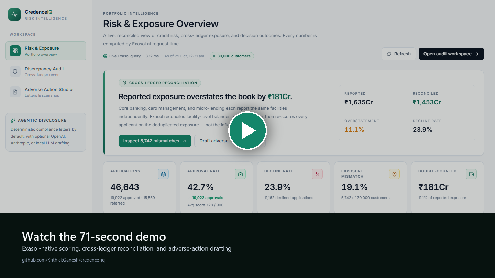
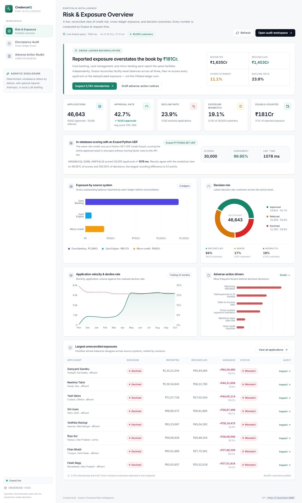
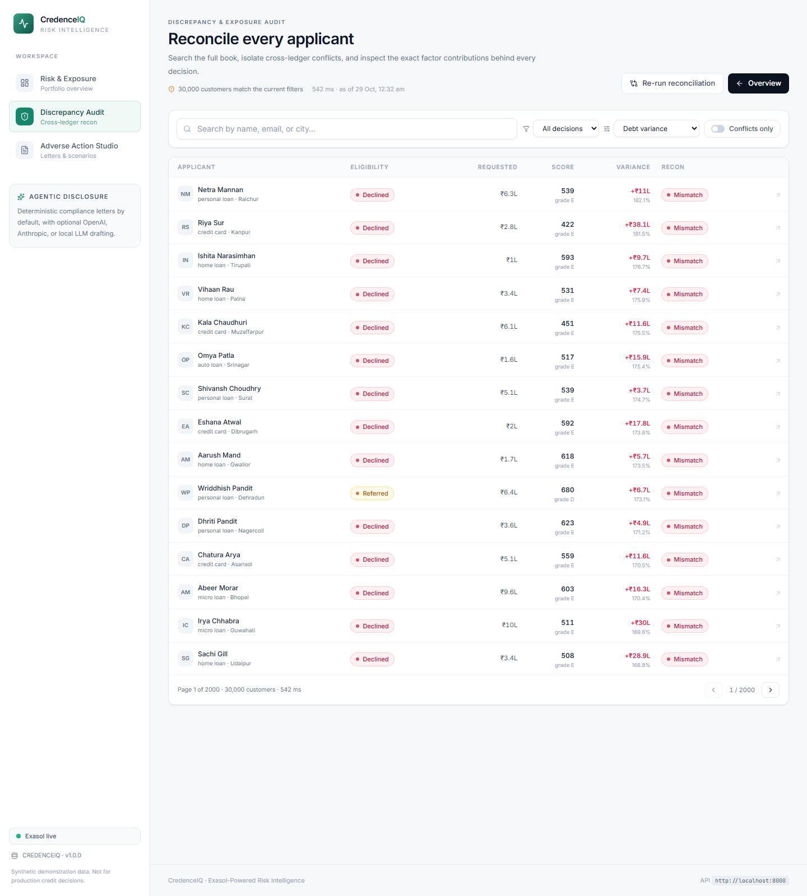
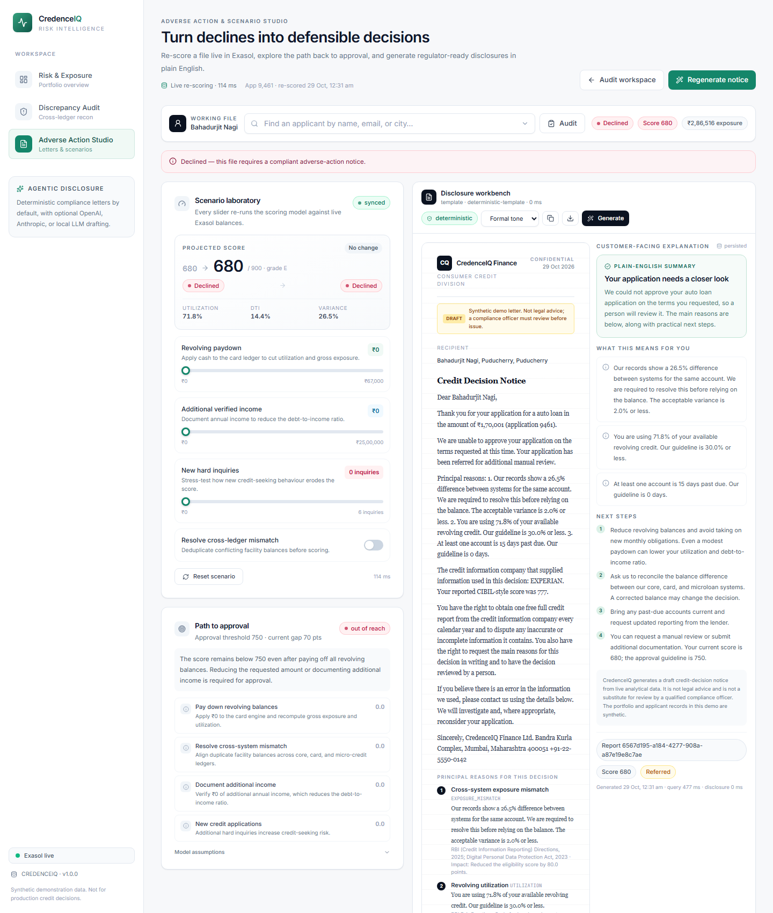
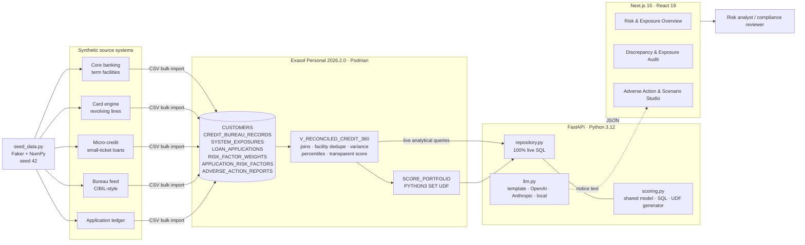
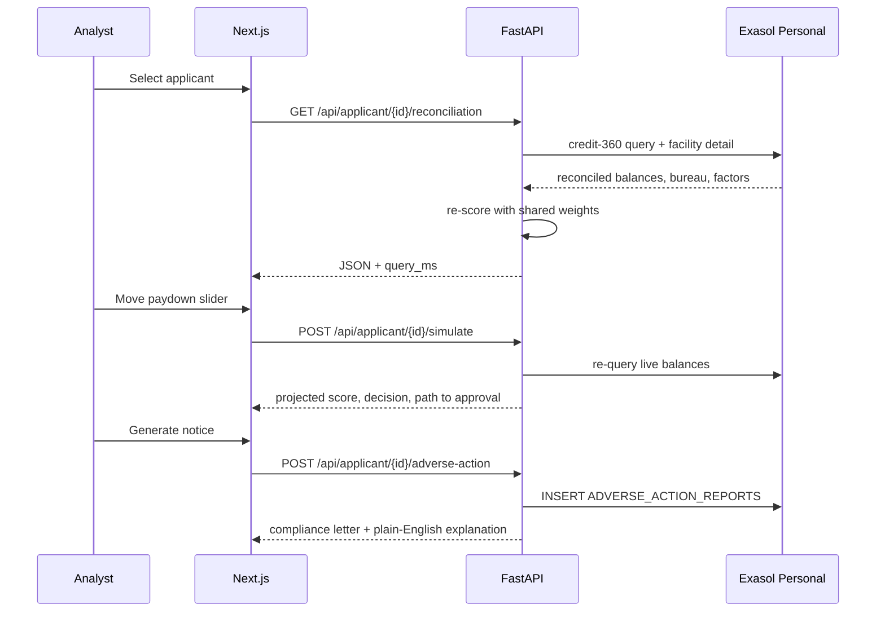

# CredenceIQ

**Enterprise risk intelligence and adverse-action platform for Indian lenders, powered by Exasol.**

CredenceIQ ingests a synthetic Indian lending book spread across three conflicting
exposure ledgers, reconciles every facility inside Exasol, re-scores applicants from the
deduplicated balances, and turns declines into regulator-ready disclosure drafts — with a
full audit trail from portfolio number to factor-level reason.

> Every screen is driven by live SQL. There is no mocked "core data" in the API layer.

The reference deployment is **Exasol Personal 2026.2.0** running locally (Podman) on
`127.0.0.1:8563`. The optional `exasol/docker-db` stack is a fallback only.

---

## Submission materials

[](docs/demo/credenceiq-demo.mp4)

| Material | Where |
| --- | --- |
| Source code | this repository (MIT) |
| README + run instructions | this file, [Quickstart](#quickstart---exasol-personal-primary) |
| Pitch deck | [docs/pitch-deck.pdf](docs/pitch-deck.pdf) · 10 slides |
| Demo video | [docs/demo/credenceiq-demo.mp4](docs/demo/credenceiq-demo.mp4) · 70 s, 1440×810, captioned |
| Dashboard screenshots | [docs/screenshots](docs/screenshots) |
| Benchmark | [Performance benchmark](#performance-benchmark) · `scripts/benchmark.py` |

There is **no hosted demo**. CredenceIQ runs against Exasol Personal on your machine; the
video walks through the deterministic seeded book, and the quickstart below reproduces the
same state end to end. The demo uses a synthetic book and generates draft notices, not legal
advice.

---

## What it demonstrates

| Capability | Implementation |
| --- | --- |
| Cross-ledger reconciliation | `V_RECONCILED_CREDIT_360` deduplicates facilities reported by core banking, card, and micro-credit systems |
| Explainable underwriting | Nine adverse-action factors with weights persisted in `RISK_FACTOR_WEIGHTS`; Python, SQL, and the UDF share one model |
| Exasol-native scoring | A generated **Python SET UDF** (`SCORE_PORTFOLIO`) scores all 30,000 applicants inside Exasol |
| What-if re-scoring | Live simulation of paydown, verified income, new inquiries, and mismatch resolution — including the exact gap to approval |
| Compliance automation | Formal notice plus a plain-English companion, deterministic by default, with an optional LLM path |
| Portfolio analytics | Decision mix, exposure topology, rejection velocity, denial drivers, utilization percentiles, conflict rankings |
| Auditability | Every adverse-action report is persisted with provider, model, generation mode, and full JSON payload |
| India-localised demo | INR lakh/crore formatting, en_IN identities and cities, CIBIL-style 300–900 scores, RBI/DPDP references |

---

## Screenshots

Captured from the seeded 30,000-customer book, with every number queried live from Exasol.

### Portfolio overview

Live cross-ledger reconciliation, portfolio KPIs, in-database UDF timing, decision mix,
rejection velocity, denial drivers, and the largest unresolved exposures.



### Discrepancy & exposure audit

Searchable book with historical vs. re-scored decisions, debt variance, reconciliation
status, and an Applicant 360 drawer for factor-level inspection.



### Adverse-action studio

Live re-scoring, path-to-approval scenarios, and the generated RBI/DPDP disclosure package
with a plain-English companion.



---

## Architecture



### Request path



---

## Tech stack

- **Data platform:** Exasol Personal `2026.2.0` (Podman), pyexasol 3.x, Python SLC `python-3.12` 11.2.0
- **Backend:** FastAPI, Pydantic 2, Uvicorn, Python 3.12+
- **Frontend:** Next.js 15.5 (App Router), React 19, TypeScript, Tailwind CSS 3.4, Recharts 3
- **Synthetic data:** Faker (`en_IN`), NumPy — deterministic with `--seed 42`
- **Optional LLM:** OpenAI, Anthropic, or any OpenAI-compatible endpoint (Ollama, vLLM, LM Studio)

---

## Quickstart — Exasol Personal (primary)

Prerequisites: the Exasol starter kit (`exakit`), Python 3.12+, Node.js 20+.

```powershell
# 1. Start the local database and confirm it is healthy
exakit start
exakit status

# 2. Create .env and paste the password the kit wrote to
#    %USERPROFILE%\.exasol-starter-kit\credentials\personal_sys_password
Copy-Item .env.example .env
notepad .env

# 3. Python environment
python -m venv .venv
.\.venv\Scripts\python -m pip install -r backend\requirements.txt

# 4. Seed (~292k rows, about 15 s on a laptop)
.\.venv\Scripts\python seed_data.py --if-empty --customers 30000

# 5. API
cd backend
..\.venv\Scripts\python -m uvicorn app.main:app --port 8000

# 6. Dashboard (new terminal)
cd frontend
npm install
npm run dev
```

| Service | URL |
| --- | --- |
| Dashboard | http://localhost:3000 |
| API docs | http://localhost:8000/docs |
| Health | http://localhost:8000/api/health |
| Exasol Personal | `127.0.0.1:8563` |

Notes:

- The password belongs in `.env` only. `.env` is gitignored; never commit it.
- `EXASOL_TLS_VERIFY=false` is required for Personal's self-signed local certificate.
- `EXASOL_POOL_SIZE=3` because Personal permits at most five concurrent sessions.
- The starter schemas `TPCH`, `ENERGY`, and `WEATHER` are left untouched. All CredenceIQ
  objects live in `CREDENCEIQ`.
- Rebuild from scratch with `.\.venv\Scripts\python seed_data.py --reset --customers 30000`.
- Generate data without touching Exasol with `--dry-run --customers 2000`.

### Optional: containerised app tier

With Exasol Personal already running on the host:

```bash
docker compose up -d --build
```

The containers reach the host database through `host.docker.internal`. The seed job runs
with `--if-empty`, so restarts are safe.

### Optional fallback: `exasol/docker-db`

Only when Exasol Personal cannot run on this machine:

```bash
docker compose -f docker-compose.docker-db.yml up -d --build
```

That stack uses the default `sys` / `exasol` credentials and publishes port `8563`.
Do **not** start it while Personal is running on the same port. It is not the primary
platform and the benchmark in this README was measured on Personal.

---

## India localisation

- **Currency:** Indian digit grouping throughout — `₹1,88,643`, `₹1,453Cr` — with lakh and
  crore abbreviations on dense screens.
- **People and places:** `en_IN` Faker names, with a curated city/state map so addresses
  are internally consistent (no "Gudivada, Madhya Pradesh").
- **Bureau scale:** CIBIL-style **300–900**, benchmark 680. The model score is also
  300–900 so the two are directly comparable.
- **Lender:** synthetic NBFC header (`CredenceIQ Finance Ltd.`, Bandra Kurla Complex,
  Mumbai) for generated notices.
- **Disclosures:** RBI Fair Practices Code, Credit Information Reporting Directions, 2025,
  Digital Lending Directions, 2025, the Integrated Ombudsman Scheme, 2021, and DPDP-style
  purpose/consent language.
- **Determinism:** `--seed 42` reproduces the same 30,000 customers and decisions.

Regulatory citations are listed in [Regulatory references](#regulatory-references).
Generated letters are **drafts for engineering demonstration, not legal advice**.

---

## Data model

The generator produces deliberate pathologies rather than clean, independent rows:

- The same facility is often reported by two or three source systems with **different
  outstanding balances**, producing realistic double counting.
- A share of applicants sit within a few points of the approval line.
- Bureau, application, and exposure records are joined on `customer_id`, but some
  customers have no latest application or no bureau record, exercising `LEFT JOIN` paths.
- Exposure balances, delinquencies, utilisation, and scores are correlated through a
  latent risk factor so charts show believable structure.
- `STATE_CODE` was widened to `VARCHAR(40)`; city/state pairs come from a curated list.

| Table | Grain | Rows (seed 42) |
| --- | --- | ---: |
| `CUSTOMERS` | one row per borrower | 30,000 |
| `CREDIT_BUREAU_RECORDS` | bureau snapshot per customer | 30,000 |
| `SYSTEM_EXPOSURES` | facility × source system | 115,733 |
| `LOAN_APPLICATIONS` | application lifecycle | 46,643 |
| `APPLICATION_RISK_FACTORS` | adverse factor per application | 69,549 |
| `RISK_FACTOR_WEIGHTS` | scoring model definition | 12 |
| `ADVERSE_ACTION_REPORTS` | generated notices | grows at runtime |

Portfolio snapshot from this seed:

| Metric | Value |
| --- | ---: |
| Reported exposure | ₹1,635Cr |
| Reconciled exposure | ₹1,453Cr |
| Double-counted exposure | ₹181.1Cr (11.1%) |
| Customers with a `MISMATCH` | 5,742 (19.1%) |
| Applications approved / referred / declined | 19,922 / 15,559 / 11,162 |
| Average eligibility score | 727.7 |

All tables use distribution keys on `CUSTOMER_ID` (except the small weights table) so
customer joins execute locally inside the Exasol MPP cluster.

### `V_RECONCILED_CREDIT_360`

The analytical view is generated at seed time from the same weights the API and UDF use. It:

1. Rolls exposures up per customer and per source system.
2. Collapses each `(customer_id, facility_ref)` to its **maximum** reported balance and
   counts how many systems reported the facility.
3. Computes `debt_variance = gross_exposure − reconciled_exposure` and
   `variance_ratio = variance / reconciled_exposure`.
4. Adds `PERCENT_RANK()` windows for exposure and utilisation.
5. Recomputes `eligibility_score`, decision, grade, and gap-to-approval in SQL.

Reconciliation classification:

| Status | Rule |
| --- | --- |
| `MISMATCH` | variance ratio > 8%, or at least 2 conflicted facilities |
| `MINOR_VARIANCE` | variance ratio > 2%, or exactly 1 conflicted facility |
| `RECONCILED` | everything else |

The list endpoint exposes two decision columns because they answer different questions:

- `decision` / `latest_decision` — the historical decision recorded on the application.
- `eligibility_decision` — the decision **recomputed from reconciled balances**, which is
  what the audit and studio screens display. Use `?eligibility_decision=DECLINED` to
  filter on the re-scored outcome.

---

## Scoring model

The model is deliberately transparent. Every applicant starts at **790** and receives
additive contributions from a persisted factor table:

| Factor | Weight | Benchmark |
| --- | ---: | --- |
| Bureau score | +0.30 per point above 680 | ≥ 680 |
| Debt-to-income | −50 at 40%, steeper above | ≤ 40% |
| Delinquencies (12m) | −35 each | 0 |
| Hard inquiries (6m) | −10 each above 2 | ≤ 2 |
| Revolving utilisation | −30 per 25 pts above 30% | ≤ 30% |
| Cross-system mismatch | −40 per 9 pts above 2% | ≤ 2% |
| Days past due | −0.60 per day | 0 |
| Collections | −25 each | 0 |
| Bankruptcy | −100 each | 0 |

- **Approved:** score ≥ 750
- **Referred:** 680 ≤ score < 750
- **Declined:** score < 680
- **Grades:** A ≥ 830, B ≥ 750, C ≥ 710, D ≥ 680, E < 680
- Scores are clamped to **300–900** and rounded to one decimal.

`backend/app/scoring.py` owns `score_metrics()` (Python), `build_score_sql()` (the view
expression), and `build_score_udf()` (the Exasol Python UDF). Changing a weight in one
place keeps the API, the view, the UDF, and the generated disclosures consistent.

---

## Exasol-native scoring UDF

`seed_data.py` installs `CREDENCEIQ.SCORE_PORTFOLIO`, a `PYTHON3 SET SCRIPT` generated
from the same `RISK_FACTOR_WEIGHTS` rows as the SQL view. It scores the whole applicant
book inside Exasol in one pass; factor rows never leave the database.

```sql
SELECT *
FROM (
    SELECT CREDENCEIQ.SCORE_PORTFOLIO(
        customer_id, bureau_score, latest_dti_ratio, delinquencies_12m,
        hard_inquiries_6m, portfolio_utilization_ratio, variance_ratio,
        max_dpd, collections_count, bankruptcies
    )
    FROM CREDENCEIQ.V_RECONCILED_CREDIT_360
) u;
```

Verify it against the view:

```bash
curl http://localhost:8000/api/scoring/udf
```

Reference result on this seed:

| Check | Result |
| --- | ---: |
| Customers scored | 30,000 |
| Score agreement within 0.05 | 29,986 (99.95%) |
| Decision agreement | 30,000 (100%) |
| Largest rounding difference | 0.1 points |
| UDF wall time | ~0.7–0.9 s warm; ~2.3 s on first call after database start |
| UDF decision mix | 15,119 approved / 7,801 referred / 7,080 declined |

The UDF requires the official Python SLC. On Exasol Personal:

```bash
exasol slc install PYTHON3 --auto-approve
```

This restarts the local database while the container is registered.

---

## API

All analytical endpoints execute live SQL against Exasol and return `query_ms`.
Interactive docs: **http://localhost:8000/docs**.

| Method | Endpoint | Purpose |
| --- | --- | --- |
| `GET` | `/api/overview` | Portfolio KPIs, exposure by system, decision mix, velocity, denial drivers, reconciliation mix, top discrepancies |
| `GET` | `/api/applications` | Paginated search with historical or re-scored decision filters, discrepancy filter, sorting, free text |
| `GET` | `/api/applicant/{customer_id}/reconciliation` | Applicant 360: profile, application, factor contributions, facility-level conflicts, bureau records |
| `POST` | `/api/applicant/{customer_id}/simulate` | Re-score under a what-if scenario and compute the path to approval |
| `POST` | `/api/applicant/{customer_id}/adverse-action` | Generate and persist a compliance letter plus plain-English explanation |
| `GET` | `/api/scoring/udf` | Run the in-database UDF and compare it with the analytical view |
| `GET` | `/api/factors` | Persisted factor weights and policy thresholds |
| `GET` | `/api/health` | API/database health, Exasol version, pool statistics |

### Examples

```bash
# Declined files with the largest exposure variance
curl "http://localhost:8000/api/applications?eligibility_decision=DECLINED&discrepancy_only=true&sort=variance&direction=desc&page_size=5"

# Applicant 360 for the demo file
curl "http://localhost:8000/api/applicant/129798/reconciliation"

# What-if: pay off the ₹22,732 card balance, verify ₹2,50,000 income, resolve the mismatch
curl -X POST "http://localhost:8000/api/applicant/129798/simulate" \
  -H "Content-Type: application/json" \
  -d '{"revolving_paydown":23000,"income_increase_annual":250000,"resolve_exposure_mismatch":true,"additional_hard_inquiries":0}'

# Formal adverse-action draft
curl -X POST "http://localhost:8000/api/applicant/129798/adverse-action" \
  -H "Content-Type: application/json" \
  -d '{"tone":"formal","include_state_disclosure":true}'
```

Adverse-action notices are only generated for **declined** or **referred** files; approved
applicants return HTTP `409` with an explanatory message.

### Application search parameters

`page`, `page_size` (1–100), `search`, `decision`
(`APPROVED|DECLINED|REFERRED`, historical application decision), `eligibility_decision`
(same values, recomputed from reconciled balances), `discrepancy_only`, `sort`
(`decision_date|application_date|variance|exposure|score|applicant|requested_amount`),
`direction` (`asc|desc`).

---

## Demo walkthrough

The seed is deterministic, so this sequence is reproducible.

1. **Overview** — reported exposure ₹1,635Cr vs reconciled ₹1,453Cr; 5,742 mismatches.
   The in-database scoring panel reports 30,000 applicants scored by the UDF.
2. **Audit** — enable *Conflicts only*; the list now filters on the re-scored eligibility
   decision. Open applicant **129798**.
3. **Applicant 360** — Manthan Aurora (Puducherry), score **675.5**, grade E, gap **74.5**
   to approval. Reported ₹1,33,878.01 vs reconciled ₹1,22,319.41 (9.45% variance).
4. **Studio** — keep 129798. Apply the full ₹23,000 revolving paydown (the seeded card
   balance is ₹22,732.10), resolve the mismatch, and add ₹2,50,000 of verified annual
   income. The score moves to **778.9** (approved).
   Individually the levers add **+11.9**, **+33.1**, and **+58.3** — none crosses 750 alone.
5. **Generate notice** — formal and plain-English drafts with principal reasons, RBI/DPDP
   references, appeal route, and the draft disclaimer. The report is persisted.
6. **UDF check** — `GET /api/scoring/udf` returns 99.95% score agreement and 100% decision
   agreement against the view.

The studio opens the borderline-declined file (currently 679.9) by default; append
`?customer=129798` to reproduce the walkthrough exactly.

---

## Dashboard

### Risk & Exposure Overview (`/`)

Headline reconciliation story, five KPI cards, the in-database UDF panel, exposure by
source system, decision mix, 12-month application velocity with decline rate, top denial
drivers, and the largest unreconciled exposures with links into the audit workspace.

### Discrepancy & Exposure Audit (`/audit`)

Filterable master list with conflict-only mode, eligibility-decision filters, sorting, and
pagination. Selecting a file opens a split-pane Applicant 360 view:

- score gauge on the 300–900 scale with refer/approve thresholds and gap to approval,
- every adverse factor with observed value, benchmark, contribution, regulation, and
  plain-language explanation,
- reported vs reconciled exposure, system shares, utilisation percentile,
- expandable facility audit showing each source system's balance, limit, DPD, and status,
- bureau snapshots.

### Adverse Action & Scenario Studio (`/studio`)

Search any applicant or jump into a borderline decline. The scenario lab re-scores the file
on a debounce as you move sliders for revolving paydown, verified income, new hard
inquiries, and mismatch resolution. It shows the projected score, decision transition,
per-action score impact, and the exact additional paydown needed to cross 750.

The workbench generates the formal notice and plain-English companion side by side, with
factor disclosures, appeal rights, tone selection, copy, and `.txt` download. Reports are
persisted with provider, model, and generation mode.

---

## Performance benchmark

The benchmark compares two **access patterns over the same Exasol data** — it is not an
Exasol-versus-another-database comparison:

- **Per-customer N+1:** four round-trips per customer (customer, bureau, latest
  application, exposures) plus Python-side reconciliation.
- **Single set-based pass:** one query against `V_RECONCILED_CREDIT_360` for the same
  customers.

```bash
python scripts/benchmark.py --sample 100 --runs 3
```

Results are printed and written to `benchmarks/results/benchmark-*.json`.

Reference run: Windows 11, Exasol Personal 2026.2.0, 100-customer sample, median of 3
measured runs, connections warm.

| Path | Round-trips | Median wall time | ms / customer |
| --- | ---: | ---: | ---: |
| Per-customer N+1 composition | 400 | 5,244.7 ms | 52.4 ms |
| Single set-based credit-360 pass | 1 | 53.8 ms | 0.5 ms |
| Portfolio aggregate scan | 1 | 131.7 ms | — |

**N+1 → single pass:** 5,190.9 ms less wall time (**99.0% lower**) for the same reconciled
figures (₹1,453Cr reconciled vs ₹1,635Cr reported).

> Numbers vary by machine, network emulation, and Exasol warm-up state. The structural
> result is stable: one set-based query replaces 400 sequential round-trips. It does not
> claim that Exasol is faster than a transactional database at transactional work.

---

## Regulatory references

The demo cites these instruments in factor metadata and generated notices. Verify the
current version on the official source before relying on any of them.

| Instrument | Date | Used for |
| --- | --- | --- |
| [Master Direction – Reserve Bank of India (Credit Information Reporting) Directions, 2025](https://www.rbi.org.in/Scripts/BS_ViewMasDirections.aspx?id=12764) | 6 Jan 2025 | Bureau data use, dispute and correction duties |
| [RBI (Digital Lending) Directions, 2025](https://www.rbi.org.in/Scripts/BS_ViewMasDirections.aspx?id=12848) | 8 May 2025 | Digital-lending disclosures and borrower communication |
| RBI Fair Practices Code for Lenders | — | Reasonable, non-discriminatory adverse-action reasons and appeal route |
| RBI Integrated Ombudsman Scheme, 2021 | 12 Nov 2021 | Escalation route in the formal notice |
| Credit Information Companies (Regulation) Act, 2005 (CICRA) | 2005 | Credit-information access, correction, and complaint rights |
| Digital Personal Data Protection Act, 2023 | 2023 | Purpose limitation, notice, and data-principal rights |
| Digital Personal Data Protection Rules, 2025 | 14 Nov 2025 | Operational consent, notice, and grievance mechanics |

> **Draft, not legal advice.** The notices are engineering demonstrations. They have not
> been reviewed by counsel, and they are not a substitute for a lender's approved
> disclosure templates or a legal opinion. Every notice carries this disclaimer.

---

## Compliance disclosure generation

Default behaviour is **deterministic and offline** (`LLM_PROVIDER=none`). The template
engine in `backend/app/llm.py` composes:

1. a formal adverse-action letter with principal reason disclosures and appeal rights,
2. a customer-facing plain-English explanation,
3. a disclaimer that the output is a demonstration, not legal advice.

The deterministic path is the tested default and requires no API key. An LLM can rewrite
the narrative, but the factors, scores, and regulatory metadata still come from Exasol.

To use a hosted provider, set it in `.env` (never in the browser):

```bash
LLM_PROVIDER=openai              # none | openai | anthropic | local
LLM_MODEL=gpt-4.1-mini
OPENAI_API_KEY=sk-...

# or
LLM_PROVIDER=anthropic
ANTHROPIC_API_KEY=sk-ant-...
```

If the provider is unavailable, times out, or returns malformed output, the API falls
back to the deterministic template and reports `generation_mode: "template"`. Every report
stores the actual provider and model used.

### Optional: Ollama with models on `D:`

Keep model weights off the system drive on Windows:

```powershell
# 1. Point Ollama at D: (persist for the user, then restart the Ollama service/app)
setx OLLAMA_MODELS "D:\ollama\models"

# 2. Pull a small instruction model
ollama pull qwen2.5:7b-instruct

# 3. In .env
# LLM_PROVIDER=local
# LOCAL_LLM_BASE_URL=http://localhost:11434/v1
# LLM_MODEL=qwen2.5:7b-instruct
# LOCAL_LLM_API_KEY=local

# 4. Restart the API and generate a notice
curl -X POST "http://localhost:8000/api/applicant/129798/adverse-action" ^
  -H "Content-Type: application/json" ^
  -d "{\"tone\":\"plain\",\"include_state_disclosure\":true}"
```

Set `LLM_TIMEOUT_SECONDS` if the first local generation is slow. Never commit API keys;
`.env` and `frontend/.env.local` are gitignored.

---

## Testing

```bash
python -m pytest backend/tests -q
```

The 11 unit tests cover threshold boundaries, clamp behaviour, contribution
reconciliation, negative-factor ordering, weight overrides, Exasol row coercion, and the
generated SQL expression. They run without a database.

```bash
cd frontend
npm run typecheck
npm run build
```

`next build` and `next dev` share the `.next` directory, so running a production build
while the dev server is up leaves the dev server serving stale manifests. Stop `npm run dev`,
delete `frontend/.next`, and start it again if pages come up unstyled or stuck on a skeleton.

End-to-end checks used for this README: `/api/health`, `/api/scoring/udf`, applicant
129798 reconciliation and simulation, and adverse-action generation in both tones.

---

## Repository layout

```
credence-iq/
├── backend/
│   ├── app/
│   │   ├── main.py            FastAPI app, CORS, error handling
│   │   ├── config.py          Pydantic settings
│   │   ├── db.py              pyexasol connection pool
│   │   ├── repository.py      all analytical and persistence SQL
│   │   ├── scoring.py         shared model, SQL view, UDF generator
│   │   ├── llm.py             providers + deterministic fallback
│   │   ├── schemas.py         API contracts
│   │   └── routers/           health, overview, applications, applicants, factors, scoring
│   ├── tests/                 deterministic scoring tests
│   ├── Dockerfile
│   └── requirements.txt
├── frontend/
│   ├── app/                   overview, audit, studio (App Router)
│   ├── components/            shell, UI primitives, Recharts charts
│   ├── lib/                   typed API client, hooks, formatters
│   └── Dockerfile
├── docs/
│   ├── pitch-deck.pdf         rendered 10-slide deck
│   ├── pitch-deck/            deck source HTML, QR asset
│   ├── demo/                  title/end cards, MP4, thumbnail
│   └── screenshots/           captured dashboard views
├── scripts/
│   ├── benchmark.py           N+1 vs single-pass access benchmark
│   ├── record_demo.py         Playwright screen recording
│   ├── build_demo.py          MP4 assembly + thumbnail
│   └── render_demo_cards.py   title/end card renderer
├── seed_data.py               DDL, synthetic generator, view + UDF creation
├── docker-compose.yml         app tier against host Exasol Personal
├── docker-compose.docker-db.yml  optional Exasol container fallback
├── Makefile
├── .env.example
├── LICENSE
└── README.md
```

---

## Design notes

- **Exasol sits in the request path.** The repository issues SQL for every page; there is
  no cache or fixture fallback that could hide a broken query.
- **The view is the contract.** Portfolio, search, and applicant queries all read from
  `V_RECONCILED_CREDIT_360`, so reconciliation rules cannot differ by screen.
- **Exposure is deduplicated before it is scored.** The score uses the reconciled balance,
  not the inflated ledger sum, which prevents double counting from silently worsening a
  decision.
- **One model, three engines.** Python, the SQL view, and the Python UDF are generated
  from the same persisted weights and checked against each other at runtime.
- **Simulation is stateless.** Each slider change recomputes scores from the applicant's
  live balances; only the generated report is persisted.
- **The frontend is a client-side consumer.** It fetches the API directly, uses typed
  contracts, and renders explicit loading/error states with recovery hints.

---

## Security & limitations

This is a **demonstration platform**, not a production credit-decision system.

- Exasol Personal uses a self-signed local certificate; TLS verification is disabled for
  local development. Pin the fingerprint or use a trusted CA in production.
- The API has no authentication or rate limiting.
- All customer data is synthetic (Faker) and does not represent real people.
- Generated notices are drafts for engineering demonstration and are **not legal
  advice**. Consult compliance counsel before using any disclosure in production.
- `LLM_PROVIDER=none` is the safe default; enabling an external provider sends factor
  text to that provider.
- The demo's `sys` database user is administrative. Use a least-privilege user in any
  shared environment.

---

## License

MIT — see [LICENSE](LICENSE).
